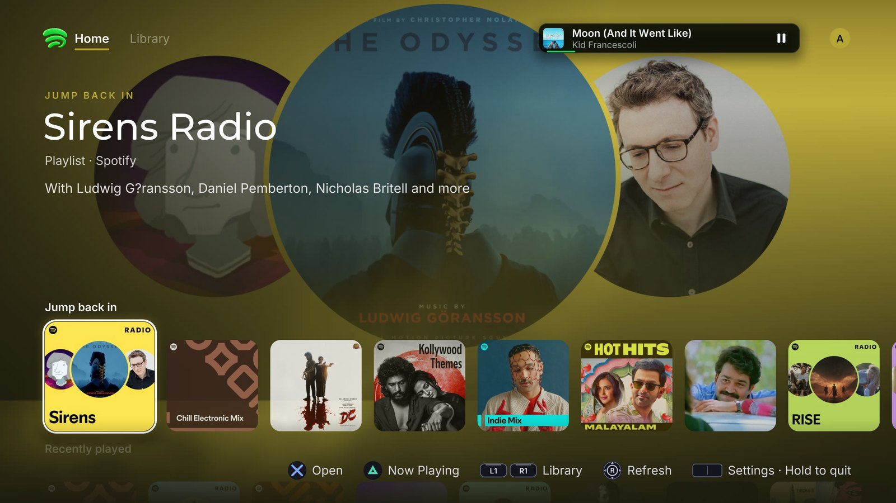
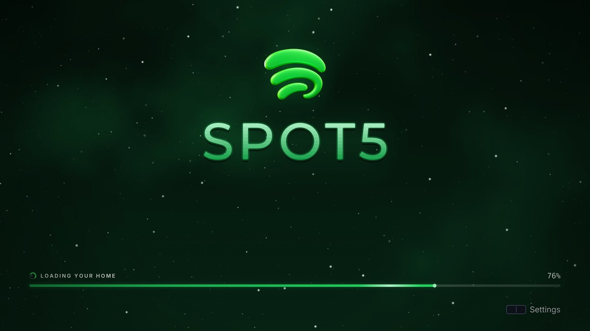
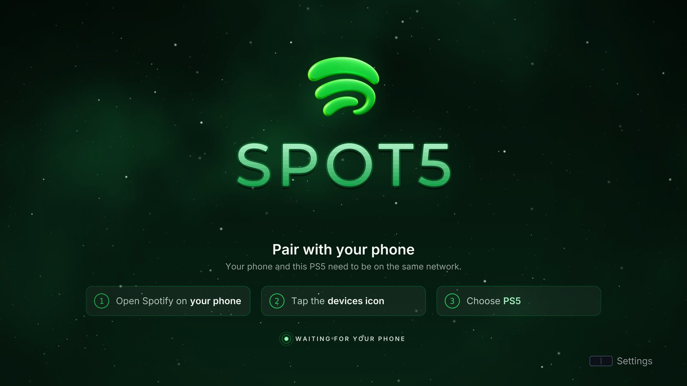
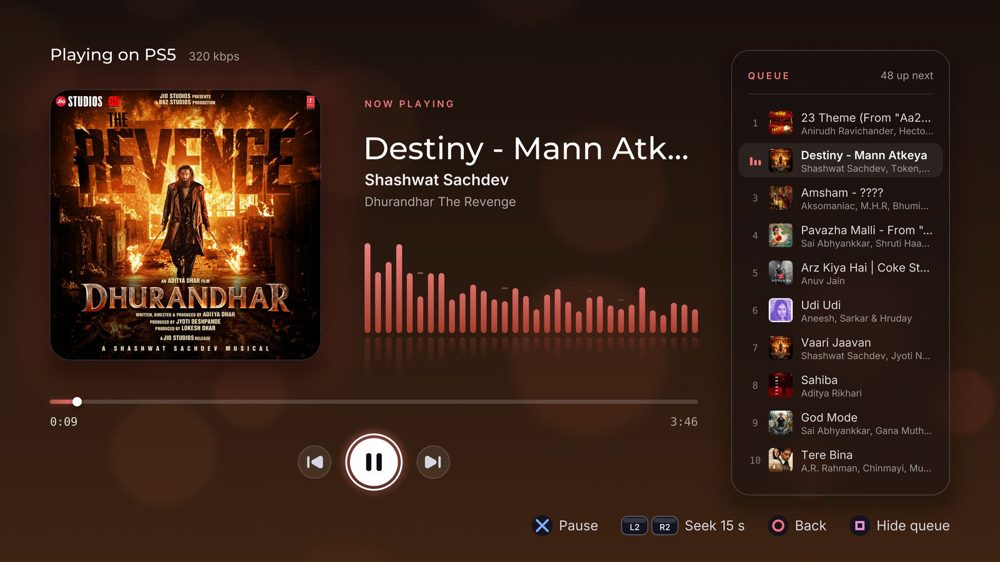
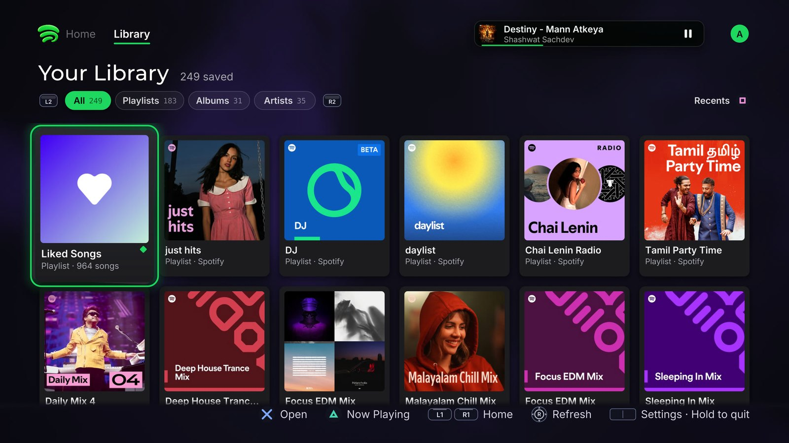
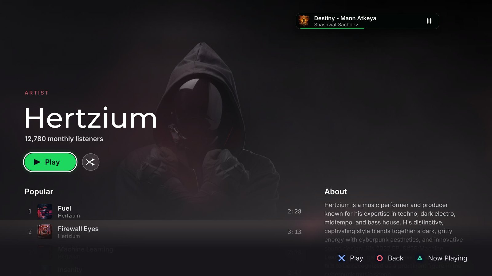
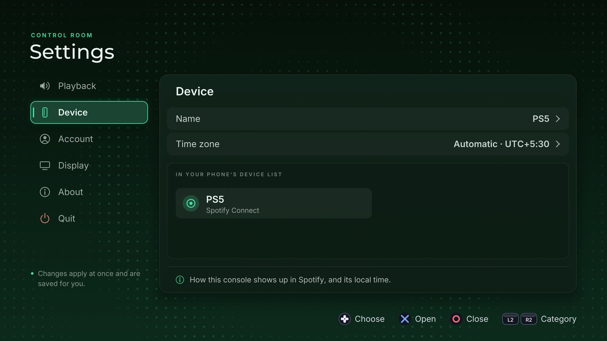

<p align="center">
  
</p>

<h1 align="center">Spot5</h1>

<p align="center">
  A native Spotify Connect player for jailbroken PlayStation 5 consoles.<br>
  Browse your music, play it on the TV, and control it from your phone — no PSN required.
</p>

<p align="center">
  
  
  
</p>

<p align="center">
  
</p>

---

## Features

**Spotify Connect on your console**
- Shows up as a speaker in the Spotify app on your phone, tablet or computer; pick it and the music plays on the PS5.
- Pair once from your phone over the local network. The login is saved, so Spot5 signs in by itself on the next launch.
- Streams at 96, 160 or 320 kbps, with its own volume on top of your phone's.

**Your music, on the TV**
- **Home** — your personal shelves, mixes and recently played, with full-bleed artist artwork and morning/evening shelves in your time zone.
- **Your Library** — playlists, albums and artists (Liked Songs pinned first), filterable and sortable.
- **Playlist and album pages** — the full track list; play from any song, or shuffle.
- **Artist pages** — wide header art, popular tracks, biography, albums and singles.
- **Now Playing** — large artwork, a live visualiser, a seekable scrubber and the queue beside it.

**Built for the couch**
- Native 4K rendering (or 1440p / 1080p), designed for a controller from the ground up.
- A mini player that follows you between screens and docks under the cover on playlist pages.
- Covers and Home are cached on the console, so the app opens instantly on the next launch.
- Hold the touchpad for 3 seconds on any screen to quit; a reduced-motion mode calms every animation.
- Registers as a media app on the console's home screen.

## Screenshots

| | |
|:---:|:---:|
|  |  |
| Launch | First-time pairing |
|  |  |
| Playlist page | Now Playing with the queue |
|  |  |
| Your Library | Artist page |
|  |  |
| Settings | Home |

## Requirements

- A jailbroken PS5 that can run homebrew apps (tested on firmware 13.00), with:
  - a homebrew launcher that registers apps from `/data/homebrew` (for example etaHEN or ShadowMountPlus);
  - an ELF loader listening on port **9021** — Spot5 uses it to start its small pairing helper the first time you pair;
  - FTP access to the console, to copy the app across.
- A **Spotify Premium** account.
- A phone (or computer) with the Spotify app, on the **same network** as the PS5.

## Installation

1. **Get the app folder.** Download `PPSA99061.zip` from the [Releases](../../releases) page and unzip it, or [build it yourself](#building-from-source).
2. **Copy it to the console.** Upload the `PPSA99061` folder to `/data/homebrew/PPSA99061` over FTP.
   From a source checkout this is one command: `make deploy PS5_HOST=<console IP>`.
3. **Register it.** Use your homebrew launcher to register the folder. A **Spot5** tile appears on the home screen.
4. **Launch Spot5** and wait for *Pair with your phone*.
5. **Pair.** On your phone, open Spotify, tap the devices icon and choose **PS5**. Spot5 signs in and opens Home.

That's it — from now on Spot5 signs in by itself. To sign out, open **Settings › Account › Forget this login**.

> **Note:** deleting the Spot5 tile from the home screen also deletes its folder on the console, including the saved login and settings. You'll need to pair again after reinstalling.

### Optional configuration

Spot5 needs no configuration file. To override the Spotify client ID it uses, place a `config.json` next to the app on the console:

```json
{ "client_id": "<your client id>" }
```

## Using Spot5

| Where | Button | Action |
|---|---|---|
| Anywhere | Touchpad (tap) | Open / close Settings |
| Anywhere | Touchpad (hold 3 s) | Quit Spot5 |
| Home, Library | L1 / R1 | Switch between Home and Your Library |
| Home, Library | R3 | Refresh |
| Home, Library, pages | △ | Open Now Playing |
| Your Library | L2 / R2, □ | Filter, sort |
| Playlist page | ✕ / L1, R1 | Play from the selected song / scroll a page |
| Now Playing | ✕ | Play / pause |
| Now Playing | ← / →, L2 / R2 | Seek 5 s, 15 s |
| Now Playing | □ | Show / hide the queue |
| Settings | L2 / R2 | Previous / next category |
| Everywhere | ◯ | Back |

### Settings

- **Playback** — audio quality, volume, and whether your phone's volume buttons control the console.
- **Device** — the name shown in Spotify's device list, and the time zone for Home (automatic from the console, or chosen from a list).
- **Account** — who is signed in, and *Forget this login*.
- **Display** — resolution (1080p, 1440p, 4K) and reduce motion.
- **About** — version details, *Clear cache* and *Reset all settings*.

## Known limitations

- Music stops when you start a game: the console suspends media apps while a game runs.
- Spotify DJ can't be played from the console yet.
- Song and artist names with accented letters may show `?` in place of those letters.

## Building from source

Spot5 builds on Linux (or WSL) and fetches its PS5 toolchain itself.

**Prerequisites:** Clang (18 or newer; set `PS5_CLANG` to choose one), `llvm-ar`, `ninja`, `make`, `python3`, `curl`, `wget`, `unzip`, `tar` and `sha256sum`.

```sh
git clone <this repository> spot5
cd spot5
make                                   # SDKs, dependencies, app and pairing helper
make deploy PS5_HOST=192.168.1.2       # copy to /data/homebrew/PPSA99061 over FTP
```

The first `make` downloads the pinned [PS5 payload SDK](https://github.com/ps5-payload-dev/sdk) and the ps5-opengl SDK into `.deps/`, then builds mbedTLS, libwebp and the vendored cspot/bell libraries. The result is `dist/PPSA99061/` and `dist/PPSA99061.zip`.

**Developing without a console:** `tools/preview.sh` renders every screen on the PC (Mesa, no GPU needed) to `build/preview/`. Host tests for the Home and Library parsers and for the pairing helper are described at the top of the files in `tests/`.

### Repository layout

| Path | What's there |
|---|---|
| `src/app/` | App start-up, the controller thread, configuration and settings |
| `src/service/` | The Spotify side: session, Home, Library, pages, covers and pairing |
| `src/screens/` | Every screen: launch, Home, Library, playlist, artist, Now Playing, Settings |
| `src/ui/`, `src/gfx/`, `src/audio/` | The UI kit, renderer and audio output |
| `helper/` | The pairing helper, started through the ELF loader during first-time pairing |
| `third_party/cspot/` | The cspot and bell sources Spot5 is built on (see `VERSION`) |
| `assets/`, `sce_sys/` | Fonts, logo, certificates, icon and the app's `param.json` |
| `tools/` | Build, deploy, preview and icon scripts |

## Credits

Spot5 stands on the work of many open-source projects. Thank you to their authors and contributors:

- [**cspot**](https://github.com/feelfreelinux/cspot) by feelfreelinux and contributors, and its maintained fork by [philippe44](https://github.com/philippe44/cspot) — the Spotify Connect engine (GPL-3.0).
- [**bell**](https://github.com/philippe44/bell) — cspot's networking, TLS and HTTP layer, with
  [nanopb](https://github.com/nanopb/nanopb) (zlib),
  [nlohmann/json](https://github.com/nlohmann/json) (MIT),
  [CivetWeb](https://github.com/civetweb/civetweb) (MIT),
  [Tremor](https://xiph.org/vorbis/) by Xiph.org (BSD),
  [picohttpparser](https://github.com/h2o/picohttpparser) (MIT),
  [tiny-AES-c](https://github.com/kokke/tiny-AES-c) (public domain) and
  [tinysvcmdns](https://github.com/geekman/tinysvcmdns) by Darell Tan (BSD), used by the pairing helper.
- [**librespot**](https://github.com/librespot-org/librespot) — the public client ID Spot5 uses by default.
- [**ps5-homebrew-ui**](https://github.com/blackbearreloaded/ps5-homebrew-ui) and the
  [**PS5 Native App Boilerplate**](https://github.com/blackbearreloaded/ps5-native-app-boilerplate) by BlackBearReloaded — the UI kit, renderer and native app foundation (GPL-3.0).
- [**ps5-opengl**](https://github.com/blackbearreloaded/ps5-opengl) with [Mesa](https://mesa3d.org/) — OpenGL 4.6 on the PS5.
- [**PS5 payload SDK**](https://github.com/ps5-payload-dev/sdk) and [**elfldr**](https://github.com/ps5-payload-dev/elfldr) by John Törnblom and contributors.
- [**SharpProspero**](https://github.com/SvenGDK/SharpProspero) by SvenGDK — the basis of the ELF converter in `tooling/native/`.
- [**Mbed TLS**](https://github.com/Mbed-TLS/mbedtls) (Apache-2.0) and [**libwebp**](https://chromium.googlesource.com/webm/libwebp) (BSD).
- [**stb**](https://github.com/nothings/stb) by Sean Barrett (public domain / MIT).
- Typefaces [Inter](https://github.com/rsms/inter), [Montserrat](https://github.com/JulietaUla/Montserrat) and [DejaVu](https://dejavu-fonts.github.io/) (SIL OFL / Bitstream Vera).
- Inigo Quilez's [2D distance functions](https://iquilezles.org/articles/distfunctions2d/) (MIT), used by the shape shader.

Full licence details are in [`THIRD_PARTY_NOTICES.md`](THIRD_PARTY_NOTICES.md).

## License

Spot5 is free software, released under the [GNU General Public License v3.0 or later](LICENSE).

Spot5 is an independent project for personal use. It is not affiliated with, endorsed by or sponsored by Spotify AB or Sony Interactive Entertainment. Spotify is a trademark of Spotify AB; PlayStation and PS5 are trademarks of Sony Interactive Entertainment Inc.
